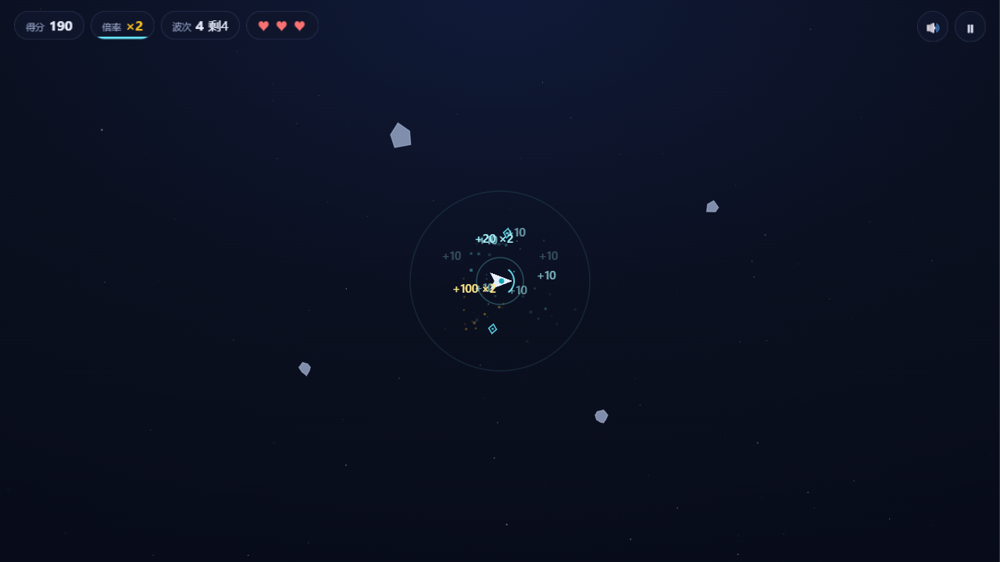
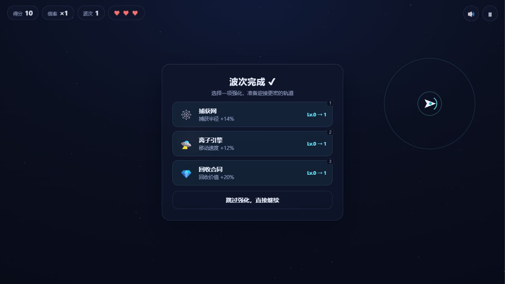
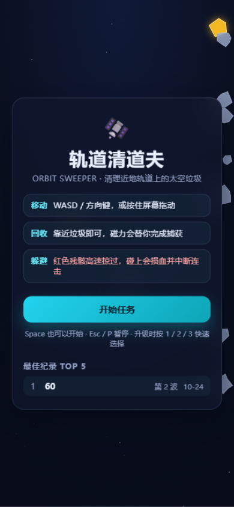

# 轨道清道夫 · Orbit Sweeper

一款关于**清理太空垃圾**的 2D 太空街机小游戏。你驾驶轨道回收船，在越来越拥挤的近地轨道上用磁力回收场捕获漂浮的碎片与报废卫星，躲避高速掠过的危险残骸，用回收所得强化飞船，看能守住多少波。

> 太空垃圾是真实世界正在发生的问题——目前近地轨道上有数以万计的 tracked debris。这个游戏把"清理轨道"做成了核心玩法，而不只是又一个打飞机。


## 运行方式

零依赖、零构建：**双击 `index.html` 即可游玩**，离线可用。也可以用任意静态服务器托管（如 GitHub Pages）。

```bash
# 可选：本地起个静态服务器
python -m http.server 8791
# 打开 http://127.0.0.1:8791
```

## 玩法

- **移动**：WASD / 方向键，或按住屏幕拖动（支持触屏）
- **回收**：靠近太空垃圾，磁力场会自动把它拉进捕获网；连续回收不失误可以叠**连击倍率**（最高 ×4），金色残骸价值 5 倍
- **拦截**：红色残骸进入磁力圈会被强减速，**持续牵引约 1.2 秒即可"稳定化"回收（+80 分）**——离得太近仍会撞船，是全游戏最高收益也最高风险的主动作
- **擦弹**：贴着残骸擦过（未碰撞）得 +15 分并累积连击，每颗残骸只结算一次；回避涂层升级可放大收益
- **连击压力**：连击 5 秒不进账就清零（HUD 倍率下有倒计时条），被撞也会清零
- **强化**：每清完一波三选一——磁力线圈 / 离子引擎 / **回收无人机** / 捕获网 / 稳定器 / 回避涂层 / 纳米装甲 / 时滞力场 / 回收合同
- **结束**：血量耗尽结算（含本局回收/拦截/擦弹/清理吨位统计，附一条太空垃圾真实科普），本地保存 TOP 5 最佳纪录



## 技术亮点

纯 HTML + CSS + JavaScript，**不依赖任何库、框架、构建工具与音频文件**：

- **固定步长物理循环**：`requestAnimationFrame` 累加器 + 1/60s 固定步长子步进，渲染帧率波动不影响模拟稳定性；受击慢动作用时间缩放（time scale）实现，而非篡改速度
- **兜底驱动**：环境挂起 rAF 时（如内嵌预览面板）自动降级到定时器驱动，游戏逻辑不会冻结
- **对象池**：粒子等短命对象循环复用，长时间游玩无 GC 尖峰
- **数据驱动调参**：波次曲线、磁力强度、升级数值全部集中在 `js/config.js`，调难度只改一个文件
- **Web Audio 实时合成**：捕获/拦截/擦弹/受击等全部音效由振荡器与噪声即时生成，捕获音随连击数逐渐升调
- **视觉工艺**：双层视差星空、受击屏幕震动、捕获粒子爆闪、拦截稳定进度弧、`tabular-nums` 防读数抖动、玻璃拟态面板
- **自适应与无障碍**：DPR 缩放画布、移动端触控、`prefers-reduced-motion` 自动关闭震动/慢动作/粒子降级、全键盘可操作（1/2/3 选强化、Esc 暂停）、切后台自动暂停



## 文件结构

```
orbit-sweeper/
├── index.html      # 页面骨架、HUD、各状态面板
├── style.css       # 主题变量、玻璃面板、响应式与动效降级
├── js/
│   ├── config.js   # 数值配置表（波次曲线 / 升级表 / 手感参数）
│   ├── utils.js    # 数学工具、随机、对象池、本地存储
│   ├── audio.js    # Web Audio 合成音效
│   ├── entities.js # 飞船、太空垃圾、危险残骸、粒子、星空
│   ├── game.js     # 固定步长循环、波次与状态机、碰撞、升级
│   └── main.js     # 输入绑定、UI 同步、主循环启动
└── shots/          # 实测截图
```

## 设计笔记

固定步长循环这个决定来自一次真实的代码评估：此前分析过一个 10 万行的太空游戏，它的物理用的是变步长欧拉积分且 dt 上限宽松，切后台回来容易出现时间错乱。这个项目在写第一行代码之前就把"模拟与渲染解耦"定为基础约束。

玩法上，第一版只能"躲避残骸、吸垃圾"，实测反馈是无聊、对高速残骸毫无办法。第二版把残骸从纯威胁改成**可拦截的高价值目标**（磁力减速 → 稳定化回收），再用擦弹奖励与连击超时把"风险 / 收益 / 节奏"三件事绑在一起——威胁物同时成为收益来源，是这一版变好玩的关键。


<p align="center">
  
</p>

## Roadmap

- [x] 升级新增：回收无人机（绕行自动回收，最多两架）
- [x] 结算页展示本局回收"吨位"，附真实太空垃圾科普小知识
- [ ] 部署 GitHub Pages，支持手机直接玩
- [ ] 升级新增：轨道减速伞（拉住高速垃圾）
- [ ] 每日挑战种子（同一串垃圾，全球比分数）

---

用 AI 辅助编码（vibecoding）完成 · 2026
